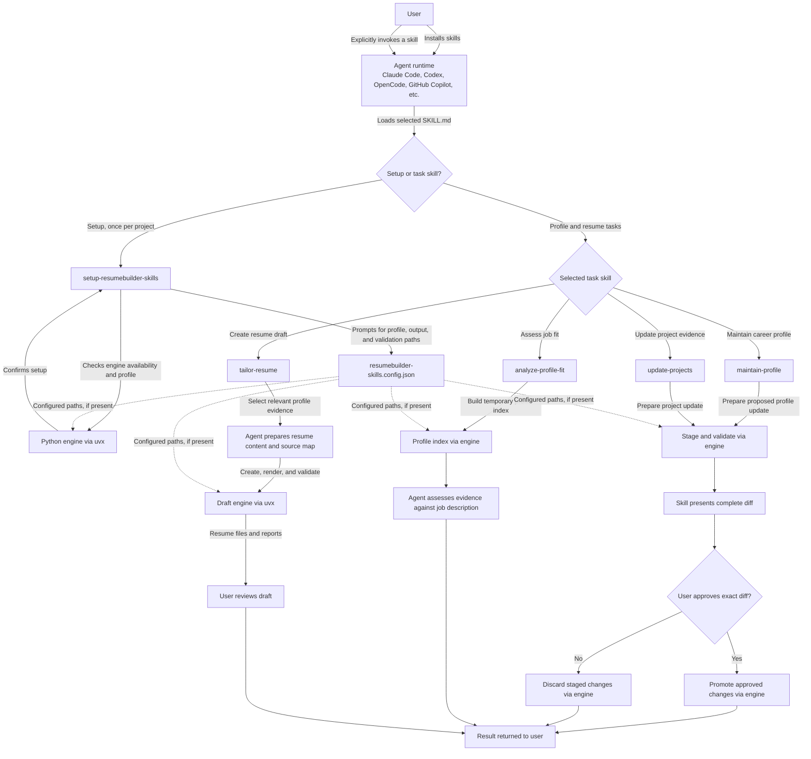

# ResumeBuilder

Turn your career history into a stronger, role-ready resume—without losing sight of the evidence behind every claim. ResumeBuilder brings a suite of AI agent skills and a Python engine together to help you build a reusable career profile, evaluate how your experience maps to a job, and create tailored, master, or market-focused resumes. Use the skills in the agent runtime you prefer—including Claude Code, Codex, OpenCode, GitHub Copilot, and more. Every draft is traceable to your profile, validated, and ready for your review.

You stay in control: ResumeBuilder never invents qualifications or submits applications on your behalf.

## Install the skills

Install the skills in the project where you want to use them. ResumeBuilder supports a range of agent runtimes, including Claude Code, Codex, OpenCode, and GitHub Copilot. Use the runtime's native plugin route when available, or install with skills.sh. To choose an agent interactively with skills.sh:

```bash
npx skills@latest add S-Dawn/ResumeBuilder
```

Or select an agent explicitly:

```bash
npx skills@latest add S-Dawn/ResumeBuilder -a <agent>
```

When prompted to select skills, install `setup-resumebuilder-skills` along with the skills you plan to use. You can install one skill by name:

```bash
npx skills@latest add S-Dawn/ResumeBuilder --skill=setup-resumebuilder-skills
```

The skills.sh installer copies the selected skill directories, not the
repository's root `scripts/` directory. Installed skills therefore invoke the
published engine with `uvx resumebuilder-tools@latest`; the
`./scripts/resume-tools` wrapper is only for running skills from a source
checkout. To update installed skills, run:

```bash
npx skills@latest update
npx skills@latest add S-Dawn/ResumeBuilder
```

This route uses manual updates. The repository also supports agent-native plugin installation routes; see [the install guide](.agents/install-block.md) for those options.

## Onboard a project

Set up ResumeBuilder once in each project where you plan to use it:

1. Open that project in your agent and run `/setup-resumebuilder-skills`.
2. Follow the prompts to choose the canonical profile directory (default: `profile/`), draft output directory (default: `generated/`), and PDF/ATS validation tools.
3. Make sure `uv` is installed. The setup skill uses `uvx` to run the published `resumebuilder-tools` engine. It writes `resumebuilder-skills.config.json` in the project root; the file is gitignored.
4. Add or maintain your career profile in the configured profile directory. See [profile/README.md](profile/README.md) for its record format and evidence conventions.
5. Use the relevant skill below. The profile and job-description content needed for a task may be sent to your configured agent model; the skills disclose this and request confirmation before reading files where required. Do not put secrets in your profile.

The setup skill is a per-project configuration step, not a profile editor. Run it before using the other ResumeBuilder skills.

## Invocation architecture (client side)

ResumeBuilder skills are installed into your chosen agent runtime and invoked explicitly by you. The agent follows the selected skill's instructions, uses the Python engine for profile and resume operations, then presents the result for your review.



The setup step is per project. Task skills can use default `profile/` and `generated/` paths when no configuration file is present. Profile updates are staged and applied only after your explicit approval; fit analysis does not save a report, and resume drafts are presented for your review rather than submitted.

## ResumeBuilder skills

Invoke these skills by name in your agent:

| Skill | What it does |
|---|---|
| `setup-resumebuilder-skills` | Configures profile and draft paths plus PDF validation for the current project. Run once per project, before the other skills. |
| `maintain-profile` | Consolidates a full, general resume or career facts into the canonical profile. Prepares and validates a complete proposed diff, then waits for your explicit approval before applying it. |
| `update-projects` | Adds or refines a project record, and updates the skills record when supported by the project evidence. Also previews and validates the whole change before asking for approval. |
| `analyze-profile-fit` | Compares the profile with a job description and reports evidence-backed matches, gaps, and positioning opportunities. It does not create a resume or save a report. |
| `tailor-resume` | Creates a job-tailored draft when you provide a job description; without one, helps create a complete master resume or a market-oriented resume. It renders and validates output for your review. |

### Maintaining your profile

Use `/maintain-profile` for broad updates from a full, general resume or career facts you provide. Use `/update-projects` for a focused project addition or revision. Both skills:

- Read the profile's editing contract and preserve existing supported claims.
- Ask you to resolve ambiguous or conflicting facts rather than guessing.
- Stage and validate a complete proposed change, show you the diff, and only apply it after you approve that exact diff.

Do not use a tailored application resume as the source for your canonical profile. Do not edit the generated `profile/index.yaml` by hand; it is rebuilt from profile metadata.

### Analyzing and creating resumes

- **Fit analysis:** Run `/analyze-profile-fit` with a pasted job description or a path to one. The assessment describes what the profile documents; it is not a hiring prediction and profile silence does not mean you lack a qualification.
- **Tailored resume:** Run `/tailor-resume` with a job description to create an application draft, fit report, source map, HTML, and PDF under the configured output directory. Review the content yourself; no application is submitted.
- **Master resume:** Run `/tailor-resume` without a job description and ask for a complete career archive. It includes distinct supported profile evidence and reports conflicts that need clarification.
- **Market resume:** Run `/tailor-resume` without a job description and ask for a market-oriented resume. The skill confirms a target role with you and uses current role-trend research when web search is available.

## Codebase and local development

### Repository layout

- `skills/` — installable skill instructions.
- `python_engine/` — profile, draft, validation, and PDF-rendering implementation.
- `profile/` — example canonical profile records and their format guide.
- `tests/` — Python unit tests.
- `pyproject.toml` and `uv.lock` — Python package metadata, dependencies, and lockfile.
- `.claude-plugin/` — plugin manifests for supported native installation routes.

### Set up the development environment

Requirements: Python 3.11 or newer and [uv](https://docs.astral.sh/uv/).

```bash
git clone https://github.com/S-Dawn/ResumeBuilder.git
cd ResumeBuilder
uv sync
```

### Run the tests and tools

Run the test suite:

```bash
uv run python -m unittest discover -s tests
```

Show the profile and draft utility commands:

```bash
uv run python -m python_engine.resume_tools --help
```

For example, validate the profile and rebuild its compact index:

```bash
uv run python -m python_engine.resume_tools validate-profile
uv run python -m python_engine.resume_tools profile-index
```

To render a resume from a YAML file, provide that file using the renderer's schema:

```bash
uv run python -m python_engine.ResumeBuilder \
  --config path/to/resume.yaml \
  --output-dir generated/
```

Add `--strict-one-page` to require a one-page PDF with extractable text and expected headings. The renderer reads `resume.yaml` by default if `--config` is omitted. See [python_engine/ResumeBuilder.py](python_engine/ResumeBuilder.py) and [python_engine/resume_tools.py](python_engine/resume_tools.py) for implementation and CLI details.

### Run skills locally without installing from PyPI

When developing new skill features or testing changes to `python_engine/`, run skills against your local code instead of the published PyPI package — no publish, no version bump required.

1. **Set dev mode** in your shell before starting your agent runtime:

   ```bash
   export RESUMEBUILDER_TOOLS_MODE=dev
   ```

2. **Create a local config** (gitignored, one-time per project):

   ```bash
   cat > resumebuilder-skills.config.json <<EOF
   {
     "profile_dir": "profile",
     "generated_dir": "generated"
   }
   EOF
   ```

3. **Invoke skills through your agent runtime** as usual. From the source
   checkout, skills call `./scripts/resume-tools`, which runs
   `uv run -m python_engine.resume_tools` in dev mode — using your local
   `python_engine/` code directly. Installed skills use
   `uvx resumebuilder-tools@latest`; they do not have the repository wrapper.

4. **Return to production** when done:

   ```bash
   unset RESUMEBUILDER_TOOLS_MODE
   ```

   Default (unset) runs `uvx resumebuilder-tools@latest` — the latest published package.

**How agent runtimes resolve skills:**

| Runtime | Skill location | Local setup |
|---|---|---|
| OpenCode | `.opencode/skills/*/` | Symlinked to `skills/*/`; edits to `skills/` are picked up automatically |
| Claude Code | `.claude-plugin/plugin.json` | Lists `skills/*/` directly |
| Codex / Copilot / VS Code | `.agents/skills/*/` | Symlinked to `skills/*/` |

**Key files:**

| File | Purpose |
|---|---|
| `scripts/resume-tools` | Wrapper: dev mode → local code via `uv run`; production → `uvx resumebuilder-tools@latest` |
| `python_engine/cli_invoke.py` | Shared Python helper honoring `RESUMEBUILDER_TOOLS_MODE` |
| `resumebuilder-skills.config.json` | Local dev config (gitignored): `profile_dir`, `generated_dir` |
| `.agents/install-block.md` | Canonical install instructions per agent runtime |

## Releasing the Python engine to PyPI

The engine is uploaded to [PyPI](https://pypi.org/project/resumebuilder-tools/) automatically by GitHub Actions. To release a new version:

1. **Choose a new version.** Check the current version in `pyproject.toml` and the versions listed on PyPI. Pick the next version that has not been published before; for example, after `1.0.2`, use `1.0.3`. Update `pyproject.toml` to that version.
2. **Test and save your changes.** Run these commands from the repository folder:

   ```bash
   uv lock
   uv run python -m unittest discover -s tests
   uv build
   ```

   If the tests or build fail, fix that before continuing. Commit the release changes and push them to GitHub's `main` branch.
3. **Create and push the version tag.** A tag is a named marker for the exact commit being released. Replace `X.Y.Z` below with your version (for example, `1.0.3`):

   ```bash
   git tag vX.Y.Z
   git push origin vX.Y.Z
   ```

   The tag must point to the commit you pushed to `main`. Pushing the tag by itself does **not** upload the package.
4. **Create the GitHub Release.** On GitHub, open **Releases → Draft a new release** and fill in:
   - **Tag:** Select the existing tag you just pushed (`vX.Y.Z`); do not create a different tag here.
   - **Target:** `main`.
   - **Release title:** `resumebuilder-tools vX.Y.Z` (for example, `resumebuilder-tools v1.0.3`).
   - **Release notes:** Briefly describe what changed in this version. Do not include secrets or personal profile data.
   - **Release type:** Leave **Pre-release** unchecked. Choose **Latest** for a normal production release.
   - **Files / discussion:** Leave empty unless you have a specific reason to attach files or start a discussion.

   Click **Publish release**. Publishing the GitHub Release is what starts the PyPI upload.
5. **Check that it worked.** In the repository's **Actions** tab, open the run for this release and confirm **Publish Python engine to PyPI** succeeds. Then check that the new version appears on PyPI and run:

   ```bash
   uvx resumebuilder-tools@X.Y.Z --help
   ```

   Replace `X.Y.Z` with the released version.

PyPI does not let you replace or reuse a version after it has been published. If anything goes wrong after publishing, fix the problem in the code and release the next version instead. For initial PyPI setup, see the detailed [PyPI publishing guide](PUBLISH_TO_PYPI.md).

## Contributing

For a substantial change, open an issue first to discuss the behavior or approach. For a pull request:

1. Keep changes focused and update the relevant skill or documentation alongside code changes.
2. Run the tests with `uv run python -m unittest discover -s tests`.
3. For changes to distributable skills, include a Changesets entry so the plugin release can be versioned.
4. Describe what changed, how you tested it, and any user-facing behavior changes.

## Bug reports

Report bugs in the [GitHub issue tracker](https://github.com/S-Dawn/ResumeBuilder/issues/new/choose). Include steps to reproduce, the expected and actual behavior, the agent/OS where relevant, and any error output. Remove personal profile data, job descriptions, credentials, and other private information from reports and logs.
